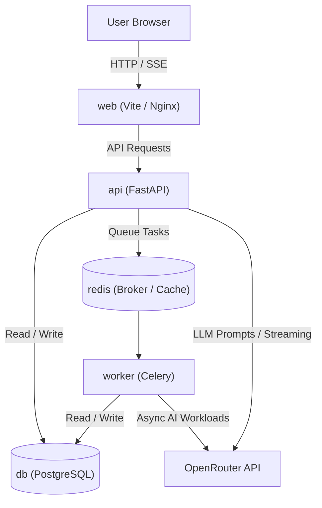

# Repository Architecture & Structural Blueprint

This document outlines the architectural boundaries, repository layout, technology stack, and service topology for `idoitmyself`.

## 1. Technology Stack

| Layer | Technology | Purpose |
| :--- | :--- | :--- |
| **Orchestration** | Docker & Docker Compose | Multi-container local environment & deployment orchestration |
| **API Backend** | Python 3.12+, FastAPI, Uvicorn | Async REST API, OpenAPI generation, AI streaming |
| **Database** | PostgreSQL | Relational persistence |
| **Cache & Queue** | Redis | Message broker & result backend for async tasks |
| **Task Worker** | Celery | Background job execution and long-running tasks |
| **AI Integration** | OpenRouter | Unified LLM routing, chat completions, streaming |
| **Frontend UI** | Vite + React + TypeScript | Fast client-side Single Page Application (SPA) |
| **Styling & Components** | Tailwind CSS + shadcn/ui | Accessible, aesthetic, high-velocity component library |

---

## 2. Service Topology (Docker Compose)



---

## 3. Directory Structure

```text
.
├── .ai/                            # AI Agent knowledge base & context
│   ├── architecture.md             # System design & structural blueprint (this file)
│   ├── conventions.md              # Coding standards, style, and rules
│   └── decisions/                  # Architectural Decision Records (ADRs)
│       └── 0001-core-tech-stack...md
├── .github/workflows/              # CI/CD (GitHub Pages deployment of the landing page)
├── docs/                           # (planned) Human-facing technical & user documentation
│   ├── architecture/               # (planned) Deep-dive technical specs & component designs
│   └── guides/                     # (planned) Developer guides, tutorials, onboarding
├── scripts/                        # (planned) Development, build, and automation utilities
├── src/                            # Application source code
│   ├── backend/                    # FastAPI application, domain logic, workers
│   │   └── app/
│   │       ├── api/v1/             # API router and endpoints (health, ai)
│   │       ├── core/               # Settings and database session setup
│   │       ├── services/           # Business logic (OpenRouter client)
│   │       ├── workers/            # Celery app and task definitions
│   │       └── models/             # (planned) SQLAlchemy models & Alembic migrations
│   └── frontend/                   # Vite + React (TypeScript) SPA, currently the static landing page
│       ├── public/                 # Static assets, CNAME for the custom domain
│       └── src/
│           ├── components/         # UI components (ParticleBackground)
│           ├── components/ui/      # (planned) shadcn/ui primitives
│           ├── pages/              # (planned) Application views / routes
│           ├── lib/                # (planned) API client, utilities, hooks
│           └── types/              # (planned) TypeScript interfaces and OpenAPI types
├── tests/                          # Automated test suites
│   ├── backend/                    # Pytest unit & integration tests
│   └── frontend/                   # (planned) Vitest / React Testing Library tests
├── docker-compose.yml              # Local container orchestration
├── AGENTS.md                       # Agent operational guidelines & repository map
├── LICENSE                         # Repository license (MIT)
└── README.md                       # Project overview & quickstart
```

Entries marked *(planned)* are part of the intended layout but do not exist yet; create them when the first file that belongs there is added.

---

## 4. Component Responsibilities

### Backend (`src/backend`)
* **API Endpoints (`app/api/`)**: Thin routers validating input with Pydantic and delegating to services.
* **Domain & Services (`app/services/`)**: Business logic and orchestrators for LLM prompts, storage operations, and task dispatches.
* **AI Client (`app/services/ai_service.py`)**: OpenRouter client wrapper that streams chat completions as Server-Sent Events.
* **Database Models (`app/models/`, planned)**: SQLAlchemy/SQLModel schemas and migrations (Alembic). The async engine and `get_db` session dependency already live in `app/core/database.py`.
* **Async Workers (`app/workers/`)**: Celery tasks for heavy computation or background jobs.

### Frontend (`src/frontend`)
* **Component Layer (`src/components/ui/`, planned)**: Pure, reusable shadcn/ui primitives.
* **Feature Views (`src/pages/`, planned)**: Composite page layouts consuming domain services.
* **API Integration (`src/lib/api.ts`, planned)**: Typed HTTP client communicating with FastAPI endpoints.

---

## 5. Architectural Principles

1. **Decoupled Architecture**: Frontend and backend are completely decoupled. Communication happens strictly over typed HTTP APIs, SSE (Server-Sent Events), or WebSockets.
2. **Container-First**: Every service must be reproducible via Docker Compose without relying on ambient local machine dependencies.
3. **Strict Separation of Concerns**: Fast, synchronous requests stay on FastAPI; compute-intensive or long-running workflows offload to Celery.
4. **Decision Traceability**: Any major architectural shift or dependency addition must be logged in `.ai/decisions/`.
