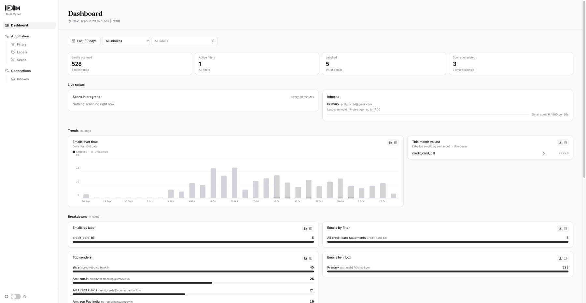

<p align="center"></p>

# IDIM — I Do It Myself

A self-hosted mailbox app. Connect your inbox and define **filters**: conditions on sender, subject, attachments and more, combined with AND / OR. Every new email that passes a filter gets that filter's label. Scanning runs automatically every 30 minutes.



## Features

- **Inboxes**: connect Gmail with OAuth (read-only). Tokens are encrypted at rest.
- **Filters**: rule trees over email fields, with regex support. Each filter applies to whole mailbox types (including inboxes connected later) and/or individual inboxes, adds one label, and can be switched on or off.
- **Labels**: unique names, with a display name you can edit. Filters add them; filters never remove them.
- **Scans**: at every :00 and :30, each inbox with an active filter is scanned for the mail received since its previous scan. Earlier mail can be scanned on demand with chosen filters (Scans › New scan). Gmail's quota is budgeted so scans stay under Google's limits.
- **Dashboard**: stats, trends, breakdowns by label and filter, scan status, and things that need attention.

## Stack

| Layer | Tech |
|---|---|
| API | Python 3.12, FastAPI, SQLAlchemy 2 (async), Alembic |
| Jobs | Celery worker and beat, RabbitMQ |
| Storage | PostgreSQL, Redis |
| Web | React, TypeScript, Vite, Tailwind, shadcn/ui |

## Quick start

Requires Docker.

1. Copy the env template and fill it in:

   ```bash
   cp .env.example .env
   ```

   | Variable | Where to get it |
   |---|---|
   | `GOOGLE_CLIENT_ID`, `GOOGLE_CLIENT_SECRET` | A Google Cloud OAuth client with the Gmail API enabled. Add `GOOGLE_REDIRECT_URI` as an authorised redirect URI. |
   | `TOKEN_ENCRYPTION_KEY` | `python -c "from cryptography.fernet import Fernet; print(Fernet.generate_key().decode())"` |

2. Start everything:

   ```bash
   docker compose up --build
   ```

| Service | URL |
|---|---|
| Web app | http://localhost:5173 |
| API docs | http://localhost:8000/docs |
| RabbitMQ UI | http://localhost:15672 |

Migrations run automatically when the API starts. The worker and beat don't hot-reload, so run `docker compose restart worker beat` after backend changes. Scanning settings (interval, batch size, quota budget) are listed in `.env.example`.

## Development checks

```bash
cd src/backend && uv run ruff check . && uv run pytest
cd src/frontend && npx tsc -b && npm run lint
```

## Project layout

```
src/backend/    FastAPI app, Celery worker and beat, migrations, tests
src/frontend/   React app
media/          Logo
```

See [AGENTS.md](AGENTS.md) for design decisions and architecture details.

## License

[MIT](LICENSE)
