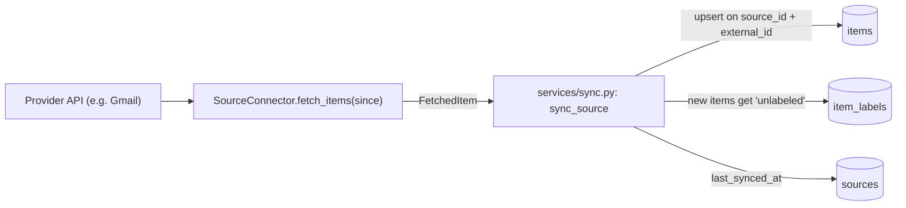

# Data Model

The backend stores data from any external source in a source-agnostic shape. Gmail is the first source; the model is designed so other sources plug in without schema changes. See [ADR 0002](../../.ai/decisions/0002-generic-sources-and-items.md) for the reasoning.

## Tables

### `sources`
A configured external data source (e.g. one Gmail account).

| Column | Type | Notes |
| :--- | :--- | :--- |
| `id` | UUID | Primary key |
| `type` | varchar | `gmail` (more later); selects the connector |
| `name` | varchar(200) | Display name |
| `config` | JSONB | Connector-specific, **non-secret** settings. Returned by the API. |
| `last_synced_at` | timestamptz | Start time of the last successful sync; passed to the connector as `since` |
| `created_at`, `updated_at` | timestamptz | |

### `items`
One piece of data from a source. For Gmail, one email.

| Column | Type | Notes |
| :--- | :--- | :--- |
| `id` | UUID | Primary key |
| `source_id` | UUID | FK → `sources.id`, `ON DELETE CASCADE` |
| `external_id` | varchar(255) | Id in the source system (Gmail message id). Unique per source. |
| `kind` | varchar(32) | `email` for Gmail |
| `title` | text | Email subject |
| `author` | varchar(512) | Email sender |
| `content` | text | Email body (plain text) |
| `occurred_at` | timestamptz | When the item happened at the source (email date). Indexed. |
| `data` | JSONB | Source-specific fields (thread id, recipients, provider labels, ...) |
| `created_at`, `updated_at` | timestamptz | |

### `labels`
Predefined (`system`) and user-created (`custom`) labels. See [ADR 0003](../../.ai/decisions/0003-labels.md).

| Column | Type | Notes |
| :--- | :--- | :--- |
| `id` | UUID | Primary key |
| `name` | varchar(100) | Display name |
| `slug` | varchar(100) | Unique, derived from the name (`"Side Projects"` → `side-projects`) |
| `kind` | varchar | `system` (seeded, read-only) or `custom` |
| `color` | varchar(7) | Optional `#rrggbb` |
| `description` | text | Optional |
| `created_at`, `updated_at` | timestamptz | |

Predefined labels: `unlabeled`, `important`, `personal`, `work`, `finance`, `travel`, `shopping`, `social`, `promotions`, `updates`, `newsletters`.

### `item_labels`
Links items to labels (many-to-many).

| Column | Type | Notes |
| :--- | :--- | :--- |
| `item_id` | UUID | FK → `items.id`, `ON DELETE CASCADE`; part of the primary key |
| `label_id` | UUID | FK → `labels.id`, `ON DELETE CASCADE`; part of the primary key; indexed |
| `assigned_by` | varchar | `system`, `manual`, `ai` or `rule` |
| `confidence` | float | 0–1 for AI assignments, otherwise NULL (check constraint) |
| `assigned_at` | timestamptz | |

## Label rules

Every item always has at least one label:

- New items start with `unlabeled` (assigned by `system`).
- Adding a label removes `unlabeled`; removing the last label restores it.
- Deleting a custom label restores `unlabeled` on items for which it was the only label.
- `unlabeled` cannot be assigned or removed by hand, and system labels cannot be edited or deleted.
- Assigning a label an item already has updates `assigned_by`/`confidence` (the latest assignment wins).

## Ingestion flow



1. `sync_source` looks up the connector for `source.type` in the registry.
2. The connector yields `FetchedItem`s changed since `source.last_synced_at`.
3. Each one is upserted on `(source_id, external_id)`, so re-syncing never duplicates items. New items get the `unlabeled` label; existing items keep their labels.
4. `last_synced_at` is set to the time the sync started and the transaction is committed.

## Adding a new source

1. Add a value to `SourceType` in `src/backend/app/models/source.py`.
2. Create a connector in `src/backend/app/sources/<name>.py`: subclass `SourceConnector`, set `source_type`, implement `fetch_items`, and decorate it with `@register_connector`.
3. Import the module in `src/backend/app/sources/__init__.py` so it registers on startup.
4. Add tests in `tests/backend/`.

## Migrations

The schema is managed with Alembic (`src/backend/migrations/`). After changing a model:

```bash
cd src/backend
alembic revision --autogenerate -m "describe the change"
# review the generated file, then
alembic upgrade head
```
